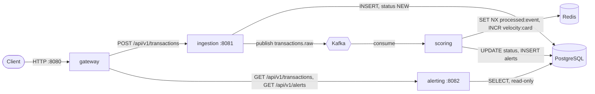
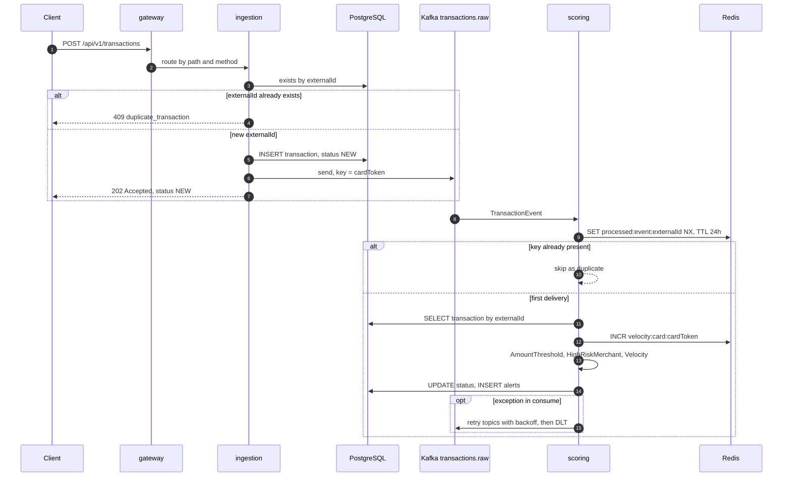
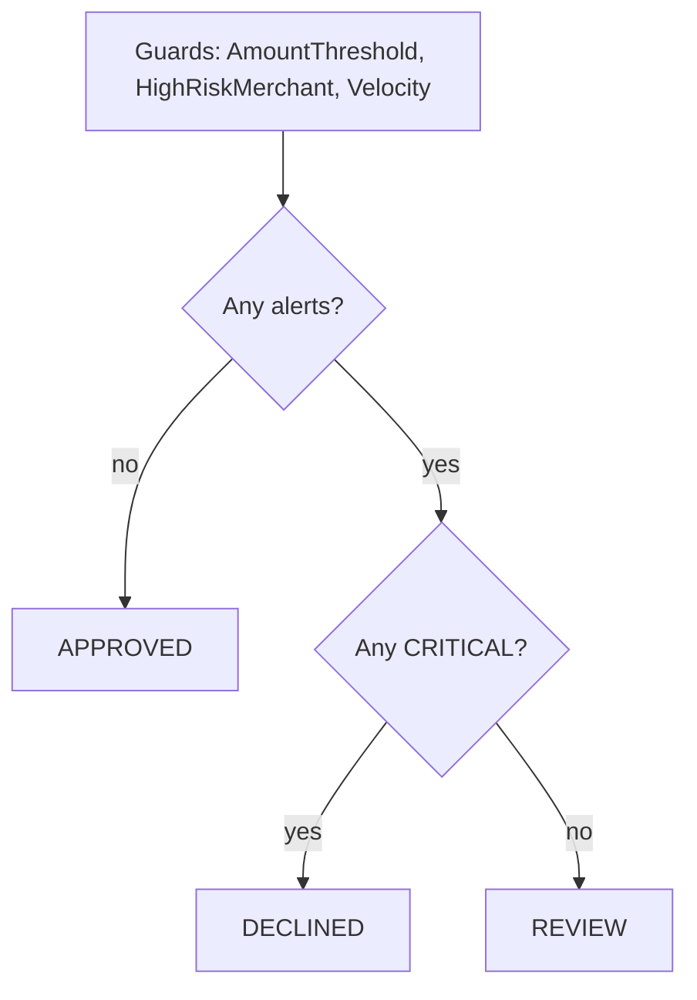

# Anti-Fraud Monitor

Событийная система антифрод-скоринга карточных транзакций: приём платежей через REST, асинхронная оценка по набору правил через Kafka, хранение результатов в PostgreSQL и выдача алертов отдельным read-сервисом.


---

## Оглавление

1. [Проблема и бизнес-контекст](#1-проблема-и-бизнес-контекст)
2. [Ключевые архитектурные решения и trade-offs](#2-ключевые-архитектурные-решения-и-trade-offs)
3. [Технологический стек](#3-технологический-стек)
4. [Anti-fraud правила](#4-anti-fraud-правила)
5. [Структура проекта](#5-структура-проекта)
6. [Быстрый старт](#6-быстрый-старт)
7. [API Documentation](#7-api-documentation)
8. [Тестирование](#8-тестирование)
9. [Идемпотентность: детально](#9-идемпотентность-детально)
10. [Roadmap](#10-roadmap)
11. [Автор](#11-автор)

---

## 1. Проблема и бизнес-контекст

Обработка карточных транзакций требует решения в момент платежа, но оценка риска включает обращения к хранилищам состояния (например, счётчики активности по карте) и набор правил, который со временем растёт. Если скоринг выполняется синхронно внутри HTTP-запроса приёма платежа, его задержка и доступность напрямую определяют задержку и доступность самого приёма.

В системе эти задачи разделены. Сервис приёма (`ingestion`) валидирует запрос, сохраняет транзакцию со статусом `NEW`, публикует событие в Kafka и отвечает `202 Accepted`. Сервис скоринга (`scoring`) читает событие, применяет правила и фиксирует итоговый статус `APPROVED`, `REVIEW` или `DECLINED` вместе со списком сработавших правил (алертов). Сервис `alerting` отдаёт транзакции и алерты на чтение. Единая точка входа — `gateway`.

Реализованы три сценария обнаружения: сумма выше порога для валюты, мерчант из списка высокого риска, всплеск числа операций по одной карте за пять минут. Повторная отправка одного платежа и повторная доставка события из Kafka обрабатываются как дубликаты (раздел [9](#9-идемпотентность-детально)).

---

## 2. Ключевые архитектурные решения и trade-offs

### Топология



### Путь транзакции



### 2.1. Асинхронный скоринг через Kafka

**Проблема.** Синхронный скоринг в запросе приёма связывает задержку и доступность приёма с Redis и вычислением правил.

**Решение.** `ingestion` сохраняет транзакцию (`NEW`), публикует `TransactionEvent` в топик `transactions.raw` с ключом `cardToken` и отвечает `202 Accepted` с заголовком `Location`. `scoring` читает топик в consumer group `antifraud-group` (`auto-offset-reset: earliest`). События сериализуются в JSON (`JacksonJsonSerializer` / `JacksonJsonDeserializer`).

**Почему Kafka, а не синхронный HTTP-вызов scoring.** Приём продолжает работать при остановке `scoring`: события накапливаются в топике и обрабатываются после восстановления.

**Почему Kafka, а не RabbitMQ.** Сообщения хранятся в журнале, порядок гарантируется внутри партиции. Ключ `cardToken` направляет все события одной карты в одну партицию, что сохраняет порядок обработки по карте и позволяет масштабировать `scoring` по числу партиций (в compose `KAFKA_NUM_PARTITIONS=3`). Явного создания топика в коде нет, используется значение брокера.

**Trade-off.** Итоговый статус появляется с задержкой: клиент получает `NEW` и узнаёт результат через `GET /api/v1/transactions` (eventual consistency). Добавляется инфраструктурный компонент. В compose развёрнут один брокер в режиме KRaft (`broker,controller`) с replication factor 1 для служебных топиков, поэтому отказоустойчивость кластера Kafka не обеспечивается.

### 2.2. Разделение записи и чтения (command/query separation)

**Проблема.** Путь записи (приём, скоринг) и путь чтения (выдача для аналитиков) имеют разные зависимости и профиль нагрузки.

**Решение.** `ingestion` обрабатывает только `POST`, `scoring` записывает результат, `alerting` обрабатывает только `GET` в `@Transactional(readOnly = true)`. `gateway` маршрутизирует один путь `/api/v1/transactions` по HTTP-методу: `POST` в `ingestion`, `GET` в `alerting`. В compose `alerting` зависит только от PostgreSQL.

**Почему не один сервис.** Read-сторона разворачивается и масштабируется независимо от записи и не зависит от Kafka и Redis при старте.

**Почему не полноценный CQRS с отдельной read-моделью.** Отдельное хранилище и проекции требуют дополнительного потока событий и вносят второй уровень eventual consistency. Здесь read-сторона читает ту же PostgreSQL.

**Trade-off.** Сервисы используют общую схему БД и общий модуль `common` (сущности, репозитории, enum-ы). Изменение сущности затрагивает все модули, а read-модель не оптимизирована отдельно от write-модели.

### 2.3. Redis для velocity-правила

**Проблема.** Правило считает число транзакций по карте за пятиминутное окно и вычисляется на каждое событие.

**Решение.** Атомарный `INCR` по ключу `velocity:card:{cardToken}`; на первом инкременте (`count == 1`) выставляется `EXPIRE` 5 минут. TTL ключа определяет границу окна.

**Почему Redis, а не `COUNT` в PostgreSQL.** `INCR` выполняется за O(1) и не нагружает OLTP-базу. Запрос `COUNT` по карте и времени выполнялся бы на каждое событие, а в схеме нет индекса по `card_token` и `occurred_at`.

**Trade-off.**
- Окно фиксированное, а не скользящее: оно открывается первой транзакцией и закрывается по TTL, поэтому серия операций на границе двух окон может пройти без срабатывания правила.
- Счётчик ведётся по времени обработки, а не по `occurredAt`.
- `INCR` и `EXPIRE` — две отдельные команды, между ними нет атомарности.
- Счётчик живёт только в Redis (`appendonly yes` в compose).

### 2.4. Идемпотентность на двух уровнях

**Проблема.** Клиенты повторяют запросы, а Kafka гарантирует доставку «не менее одного раза».

**Решение.**
- Уровень API: клиент передаёт `externalId` (UUID). Предварительная проверка `existsByExternalId` возвращает `409`, уникальное ограничение на `transactions.external_id` служит страховкой на уровне БД.
- Уровень consumer: `SET NX` с TTL 24 часа по ключу `processed:event:{externalId}` выполняется до обработки и отсекает повторную доставку, не обращаясь к PostgreSQL.

**Почему Redis `SET NX`, а не проверка статуса в БД.** Операция атомарна, выполняется за O(1), а TTL ограничивает объём хранимых ключей. Повторное событие не доходит до guard-ов, поэтому velocity-счётчик не увеличивается дважды.

**Trade-off.** Ключ устанавливается до обработки, и его жизненный цикл не связан с транзакцией БД. Границы гарантий описаны в разделе [9](#9-идемпотентность-детально).

### 2.5. Retry с отдельными топиками и DLT

**Проблема.** Временные сбои (БД, Redis, транзакция ещё не видна для чтения) не должны блокировать обработку остальных карт.

**Решение.** `@RetryableTopic(backOff = @BackOff(delay = 2000, multiplier = 2.0))` на consumer. Исключение в `consume()` отправляет событие в retry-топик с экспоненциальной задержкой (2 с, множитель 2.0), после исчерпания попыток событие попадает в DLT. Retry-топики и DLT создаются Spring Kafka автоматически. Число попыток явно не задано, используется значение по умолчанию Spring Kafka.

**Почему non-blocking retry, а не блокирующий `DefaultErrorHandler`.** При блокирующем повторе партиция стоит, пока обрабатывается проблемное сообщение, и задерживаются события других карт из той же партиции.

**Trade-off.** Повторно обрабатываемые события выходят из порядка относительно остальных событий той же карты. Растёт число топиков. Обработчика DLT (`@DltHandler`) в коде нет: сообщения накапливаются в DLT и доступны для просмотра через Kafka UI.

### 2.6. Правила как стратегии (`Guard`)

**Решение.** Интерфейс `Guard` (`evaluate(Transaction)` и `getRule()`) реализуют три `@Component`. `GuardFilterService` получает `List<Guard>` через внедрение зависимостей и выполняет все правила, превращая каждое нарушение в `Alert`. Новое правило добавляется классом-компонентом и значением в enum `Rule`, без изменения `GuardFilterService`.

**Trade-off.** Правила выполняются последовательно и все целиком, без досрочного выхода после `CRITICAL`. `VelocityGuard` имеет побочный эффект (инкремент счётчика) внутри `evaluate`.

### 2.7. Поведение при деградации Redis

`VelocityGuard` трактует `null` в ответе `INCR` как отсутствие нарушения (fail-open). Недоступность Redis выражается исключением, которое уходит в retry-цепочку (п. 2.5), так как та же зависимость используется проверкой идемпотентности. Решение «пропустить проверку» ограничено случаем `null`.

---

## 3. Технологический стек

| Слой | Технология | Версия | Назначение |
|---|---|---|---|
| Язык | Java | 21 | `java.version=21` в parent POM |
| Фреймворк | Spring Boot | 4.1.2 | `spring-boot-starter-parent` |
| API Gateway | Spring Cloud Gateway (WebFlux) | Spring Cloud 2025.1.4 | Маршрутизация по пути и HTTP-методу |
| Брокер | Apache Kafka (KRaft) | 3.7.0 | Транспорт событий `transactions.raw`, retry-топики, DLT |
| Клиент Kafka | Spring Kafka (`spring-boot-starter-kafka`) | управляется Boot | `KafkaTemplate`, `@KafkaListener`, `@RetryableTopic` |
| База данных | PostgreSQL | 16 | Транзакции и алерты |
| Доступ к данным | Spring Data JPA / Hibernate | управляется Boot | Сущности, репозитории |
| Состояние | Redis + Spring Data Redis | 7 (`redis:7-alpine`) | Velocity-счётчики, ключи идемпотентности |
| Валидация | Jakarta Validation (`spring-boot-starter-validation`) | управляется Boot | Проверка входного DTO |
| Сборка | Maven (multi-module), Lombok | 3.9 (образ сборки) | 5 модулей |
| Контейнеры | Docker, Docker Compose | — | Локальное окружение целиком |
| Мониторинг брокера | Kafbat Kafka UI | `latest` | Просмотр топиков, retry-топиков и DLT |
| Операционные эндпоинты | Spring Boot Actuator (gateway) | управляется Boot | `health`, `info`, `gateway` |
| Тесты | JUnit 5, Mockito, AssertJ, Spring MockMvc | управляется Boot | Unit и web-slice тесты |

### Сборка образов

Dockerfile сервисов `ingestion`, `scoring`, `alerting` построены по одной схеме (multi-stage):

1. Стадия сборки `maven:3.9-eclipse-temurin-21`: сначала копируются только `pom.xml` всех модулей и выполняется `mvn dependency:go-offline`, поэтому слой с зависимостями кэшируется и не пересобирается при изменении исходников.
2. Копируются исходники `common` и целевого модуля, сборка `mvn -pl common,<module> -am clean package -DskipTests`.
3. Финальный образ `eclipse-temurin:21-jre` содержит только собранный `app.jar`.

`.dockerignore` исключает `target/`, `.idea/`, `*.iml`, `.git/`, `_legacy/`, `*.log`, `.DS_Store`. `.gitignore` исключает `target/`, `.idea/`, `*.iml`, `.DS_Store`, `*.log`, `.env`.

---

## 4. Anti-fraud правила

| Правило (`Rule`) | Severity | Условие срабатывания |
|---|---|---|
| `AMOUNT_THRESHOLD` | `MEDIUM` | Сумма строго больше порога для валюты транзакции |
| `HIGH_RISK_MERCHANT` | `HIGH` | `merchantName` точно (с учётом регистра) совпадает с одним из: `Casino`, `Online Poker`, `Crypto Exchange`, `Gambling`, `Wire Transfer` |
| `VELOCITY` | `CRITICAL` | Более 5 транзакций с одним `cardToken` в пятиминутном окне |

Пороги `AMOUNT_THRESHOLD`:

| Валюта | Порог |
|---|---|
| EUR | 5 000 |
| CHF | 5 000 |
| CAD | 7 000 |
| AUD | 8 000 |
| BRL | 30 000 |
| JPY | 800 000 |

Сравнение строгое: сумма, равная порогу, не создаёт алерт. Шестая и последующие транзакции карты в окне создают алерт `VELOCITY`. Уровень `LOW` определён в `AlertSeverity`, но ни одно правило его не использует.

### Логика итогового статуса

| Результат оценки | Статус |
|---|---|
| Сработавших правил нет | `APPROVED` |
| Есть алерт с severity `CRITICAL` | `DECLINED` |
| Есть алерты, ни один не `CRITICAL` | `REVIEW` |

Начальный статус транзакции при создании — `NEW`. Статус `DECLINED` в текущем наборе правил возможен только при срабатывании `VELOCITY`.



---

## 5. Структура проекта

```
anti-fraud-monitor/
├── pom.xml                         # parent POM: Spring Boot 4.1.2, Spring Cloud 2025.1.4, 5 модулей
├── docker-compose.yaml             # postgres, redis, kafka, kafka-ui, ingestion, scoring, alerting, gateway
├── .dockerignore
├── .gitignore
│
├── common/                         # общий модуль: модель данных и контракт события
│   └── src/main/java/com/zverev/
│       ├── dto/                    # TransactionEvent (record) - событие в Kafka
│       ├── entity/                 # Transaction, Alert
│       │   └── enums/              # AlertSeverity, CurrencyCode, MerchantCountry, Rule, TransactionStatus
│       ├── exception/              # TransactionNotFoundException
│       └── repository/             # TransactionRepository, AlertRepository
│
├── ingestion/                      # приём транзакций (write), порт 8081
│   ├── Dockerfile
│   └── src/
│       ├── main/java/com/zverev/ingestion/
│       │   ├── config/             # JpaConfig (@EntityScan, @EnableJpaRepositories)
│       │   ├── controller/         # TransactionController (POST)
│       │   ├── dto/                # TransactionRequest, TransactionCreatedResponse
│       │   ├── exception/          # GlobalExceptionHandler, TransactionAlreadyExistsException
│       │   ├── kafka/              # TransactionEventProducer
│       │   └── service/            # TransactionService
│       ├── main/resources/application.yaml
│       └── test/                   # TransactionControllerTest, TransactionServiceTest
│
├── scoring/                        # асинхронный скоринг (consumer), без HTTP-порта
│   ├── Dockerfile
│   └── src/
│       ├── main/java/com/zverev/scoring/
│       │   ├── dto/                # GuardViolation
│       │   ├── guard/              # Guard, AmountThresholdGuard, HighRiskMerchantGuard, VelocityGuard
│       │   ├── kafka/              # TransactionEventConsumer (@RetryableTopic, идемпотентность, статус)
│       │   └── service/            # GuardFilterService
│       ├── main/resources/application.yaml
│       └── test/                   # AmountThresholdGuardTest, HighRiskMerchantGuardTest,
│                                   # VelocityGuardTest, TransactionEventConsumerTest
│
├── alerting/                       # чтение транзакций и алертов (read), порт 8082
│   ├── Dockerfile
│   └── src/
│       ├── main/java/com/zverev/alerting/
│       │   ├── config/             # JpaConfig
│       │   ├── controller/         # AlertController, TransactionQueryController (GET)
│       │   ├── dto/                # AlertResponse, TransactionResponse
│       │   └── service/            # AlertQueryService, TransactionQueryService (readOnly, маскирование карты)
│       ├── main/resources/application.yaml
│       └── test/                   # TransactionQueryControllerTest
│
└── gateway/                        # единая точка входа, порт 8080
    ├── Dockerfile
    └── src/main/
        ├── java/com/zverev/gateway/GatewayApplication.java
        └── resources/application.yaml   # маршруты, Actuator
```

### Модель данных

Схема создаётся Hibernate (`ddl-auto: update` в `ingestion` и `scoring`, `validate` в `alerting`). Enum-ы хранятся как строки (`EnumType.STRING`). Все колонки, кроме `transactions.status`, помечены `updatable = false`.

| Таблица | Колонки |
|---|---|
| `transactions` | `id` (IDENTITY), `external_id` (UUID, NOT NULL, UNIQUE), `card_token`, `amount` (precision 19, scale 4), `currency_code` (length 3), `merchant_name`, `merchant_country`, `status` (length 20), `occurred_at`, `created_at` |
| `alerts` | `id` (IDENTITY), `transaction_id` (FK на `transactions`, NOT NULL), `rule`, `severity`, `message` (length 500), `created_at` |

Связь `Transaction` — `Alert`: `@OneToMany(cascade = ALL, orphanRemoval = true)`, на стороне `Alert` — `@ManyToOne(fetch = LAZY)`.

---

## 6. Быстрый старт

### Требования

- Docker и Docker Compose v2
- Для запуска сервисов вне Docker дополнительно: JDK 21, Maven 3.9

### Запуск

<!-- TODO: заменить [your-username] на GitHub-логин -->
```bash
git clone https://github.com/[your-username]/anti-fraud-monitor.git
cd anti-fraud-monitor
docker compose up -d --build
docker compose ps
```

Docker Compose поднимает инфраструктуру с healthcheck-ами (`postgres`: `pg_isready`, `redis`: `redis-cli ping`, `kafka`: `kafka-topics.sh --list`) и запускает сервисы в порядке `depends_on`: `ingestion` ждёт healthy `postgres` и `kafka`, `scoring` ждёт healthy `postgres`, `redis`, `kafka`, `alerting` ждёт healthy `postgres`, `gateway` стартует после `ingestion` и `alerting`. Данные сохраняются в томах `pgdata`, `redisdata`, `kafkadata`.

> `alerting` запускается с `ddl-auto: validate` и требует существующей схемы, которую создаёт `ingestion` (`ddl-auto: update`). Если `alerting` остановился с ошибкой валидации схемы, достаточно повторить `docker compose up -d alerting` после старта `ingestion`.

### Сервисы и порты

| Сервис | Контейнер | Порт на хосте | Назначение |
|---|---|---|---|
| gateway | `antifraud-gateway` | 8080 | Единая точка входа для API |
| ingestion | `antifraud-ingestion` | 8081 | Приём транзакций |
| alerting | `antifraud-alerting` | 8082 | Чтение транзакций и алертов |
| scoring | `antifraud-scoring` | не публикуется | Kafka consumer, скоринг |
| postgres | `antifraud-postgres` | 5433 (внутри сети 5432) | БД `antifraud`, пользователь `antifraud` |
| redis | `antifraud-redis` | 6379 | Velocity и идемпотентность (AOF включён) |
| kafka | `antifraud-kafka` | 9092 (внутри сети 29092) | Брокер, KRaft, 3 партиции по умолчанию |
| kafka-ui | `antifraud-kafka-ui` | 8090 | Веб-интерфейс Kafka, кластер `local-kafka` |

### Проверка сценария velocity

Шесть транзакций по одной карте: первые пять получают `APPROVED`, шестая — `DECLINED` с алертом `VELOCITY`.

```bash
for i in $(seq 1 6); do
  curl -s -X POST http://localhost:8080/api/v1/transactions \
    -H "Content-Type: application/json" \
    -d "{\"externalId\":\"$(uuidgen)\",\"cardToken\":\"card-1234\",\"amount\":100,\"currency\":\"EUR\",\"merchantName\":\"Shop\",\"merchantCountry\":\"GERMANY\",\"occurredAt\":\"$(date -u +%Y-%m-%dT%H:%M:%SZ)\"}"
  echo
done

curl -s http://localhost:8080/api/v1/transactions
curl -s http://localhost:8080/api/v1/alerts
```

Топики, retry-топики и DLT можно просмотреть в Kafka UI: http://localhost:8090.

### Запуск сервисов вне Docker

Значения по умолчанию в `application.yaml` указывают на `localhost` (PostgreSQL `5433`, Kafka `9092`, Redis `6379`).

```bash
docker compose up -d postgres redis kafka
mvn clean package -DskipTests
java -jar ingestion/target/ingestion-0.0.1-SNAPSHOT.jar
java -jar scoring/target/scoring-0.0.1-SNAPSHOT.jar
java -jar alerting/target/alerting-0.0.1-SNAPSHOT.jar
java -jar gateway/target/gateway-0.0.1-SNAPSHOT.jar
```

### Остановка

```bash
docker compose down        # остановить, сохранить данные
docker compose down -v     # остановить и удалить тома
```

---

## 7. API Documentation

Базовый адрес через gateway: `http://localhost:8080`. Сервисы также доступны напрямую: `ingestion` на `:8081`, `alerting` на `:8082`.

### Маршрутизация gateway

| Route id | Метод | Путь | Целевой сервис |
|---|---|---|---|
| `ingestion-create` | POST | `/api/v1/transactions` | `ingestion` (`INGESTION_URI`, по умолчанию `http://localhost:8081`) |
| `alerting-transactions` | GET | `/api/v1/transactions` | `alerting` (`ALERTING_URI`, по умолчанию `http://localhost:8082`) |
| `alerting-alerts` | GET | `/api/v1/alerts` | `alerting` |

### 7.1. Создание транзакции

`POST /api/v1/transactions`, `Content-Type: application/json`

| Поле | Тип | Ограничения |
|---|---|---|
| `externalId` | UUID | обязательное, ключ идемпотентности |
| `cardToken` | string | не пустое, до 255 символов |
| `amount` | decimal | обязательное, больше 0, до 15 цифр в целой части и до 4 в дробной |
| `currency` | enum | `CAD`, `EUR`, `JPY`, `BRL`, `AUD`, `CHF` |
| `merchantName` | string | не пустое, до 255 символов |
| `merchantCountry` | enum | `CANADA`, `GERMANY`, `JAPAN`, `BRAZIL`, `AUSTRALIA`, `SWITZERLAND` |
| `occurredAt` | ISO-8601 instant | обязательное, не в будущем |

```bash
curl -i -X POST http://localhost:8080/api/v1/transactions \
  -H "Content-Type: application/json" \
  -d '{
    "externalId": "3f8c1a52-7a0e-4a58-9d3b-6a1d2b7c9e10",
    "cardToken": "card-1234",
    "amount": 100.00,
    "currency": "EUR",
    "merchantName": "Shop",
    "merchantCountry": "GERMANY",
    "occurredAt": "2026-10-29T10:00:00Z"
  }'
```

**202 Accepted** — транзакция сохранена, событие опубликовано. Заголовок `Location: /api/v1/transactions/1`.

```json
{
  "transactionId": 1,
  "status": "NEW"
}
```

**400 Bad Request** — ошибка валидации (поля и сообщения через `;`) или нечитаемое тело (некорректный JSON, неизвестное значение enum).

```json
{ "error": "externalId: must not be null" }
```

```json
{ "error": "Invalid request body: ..." }
```

**409 Conflict** — транзакция с таким `externalId` уже существует.

```json
{
  "error": "duplicate_transaction",
  "message": "Transaction with externalId 3f8c1a52-7a0e-4a58-9d3b-6a1d2b7c9e10 already exists",
  "externalId": "3f8c1a52-7a0e-4a58-9d3b-6a1d2b7c9e10"
}
```

| Код | Условие |
|---|---|
| 202 | Принято, статус `NEW` |
| 400 | Не пройдена валидация или тело не читается |
| 409 | Дубликат `externalId` |

### 7.2. Список транзакций

`GET /api/v1/transactions`

```bash
curl -s http://localhost:8080/api/v1/transactions
```

**200 OK** — массив всех транзакций с вложенными алертами. `cardTokenMasked` содержит последние четыре символа токена в формате `**** 1234`; для `null` или токена короче четырёх символов возвращается `****`. Пагинации нет.

```json
[
  {
    "id": 6,
    "cardTokenMasked": "**** 1234",
    "amount": 100.0000,
    "currency": "EUR",
    "merchantName": "Shop",
    "merchantCountry": "GERMANY",
    "status": "DECLINED",
    "occurredAt": "2026-10-29T10:00:00Z",
    "createdAt": "2026-10-29T10:00:01.482913Z",
    "alerts": [
      {
        "rule": "VELOCITY",
        "severity": "CRITICAL",
        "message": "Velocity exceeded for card card-1234: 6 transactions in last 5 minutes",
        "createdAt": "2026-10-29T10:00:01.530117Z"
      }
    ]
  }
]
```

`status` принимает значения `NEW`, `APPROVED`, `REVIEW`, `DECLINED`.

### 7.3. Список алертов

`GET /api/v1/alerts`

```bash
curl -s http://localhost:8080/api/v1/alerts
```

**200 OK** — массив всех алертов.

```json
[
  {
    "rule": "HIGH_RISK_MERCHANT",
    "severity": "HIGH",
    "message": "High-risk merchant category: Casino",
    "createdAt": "2026-10-29T10:05:12.204871Z"
  }
]
```

`rule`: `AMOUNT_THRESHOLD`, `HIGH_RISK_MERCHANT`, `VELOCITY`. `severity`: `LOW`, `MEDIUM`, `HIGH`, `CRITICAL`.

### 7.4. Операционные эндпоинты gateway

Spring Boot Actuator открывает `health`, `info`, `gateway`.

```bash
curl -s http://localhost:8080/actuator/health
curl -s http://localhost:8080/actuator/gateway/routes
```

---

## 8. Тестирование

| Сервис | Класс | Тип | Количество |
|---|---|---|---|
| ingestion | `TransactionControllerTest` | `@WebMvcTest` + `MockMvc` | 4 |
| ingestion | `TransactionServiceTest` | Mockito | 2 |
| scoring | `AmountThresholdGuardTest` | Unit | 4 |
| scoring | `HighRiskMerchantGuardTest` | Unit | 3 |
| scoring | `VelocityGuardTest` | Mockito | 4 |
| scoring | `TransactionEventConsumerTest` | Mockito | 5 |
| alerting | `TransactionQueryControllerTest` | `@WebMvcTest` + `MockMvc` | 2 |

### Запуск

```bash
mvn test
```

---

## 9. Идемпотентность: детально

Идемпотентность реализована на двух независимых уровнях, потому что повтор возможен в двух разных местах: на входе (клиент) и в потоке событий (брокер).

### Уровень 1. API и БД

1. Клиент генерирует `externalId` (UUID) и передаёт его в каждом запросе по одному платежу.
2. `TransactionService.process` выполняет `existsByExternalId`; при совпадении выбрасывается `TransactionAlreadyExistsException`, которую `GlobalExceptionHandler` преобразует в `409` с телом `duplicate_transaction`. Запись и событие не создаются.
3. Колонка `transactions.external_id` имеет ограничение `UNIQUE`, на уровне БД дубликат невозможен.

Клиент, не получивший ответ, может безопасно повторить запрос: `409` означает, что платёж уже принят.

### Уровень 2. Consumer (Redis `SET NX`)

```
ключ:       processed:event:{externalId}
операция:   setIfAbsent(key, "1", Duration.ofHours(24))   // SET NX с TTL, одна атомарная команда
true:       первая доставка - обработка продолжается
false:      дубликат - consume() завершается без обращения к БД и guard-ам
```

Проверка выполняется первой строкой `consume()`. Для дубликата не вызываются `findByExternalId`, `GuardFilterService.filter` и `save` (проверено тестом `duplicateEvent_skipped`). Благодаря этому повторная доставка не увеличивает velocity-счётчик.

### Поведение в граничных случаях

| Сценарий | Результат |
|---|---|
| Повторный `POST` с тем же `externalId` | `409`, запись и событие не создаются |
| Повторная доставка события в течение 24 часов | Событие пропускается, статус и алерты не меняются |
| Повторная доставка по истечении TTL (24 часа) | Ключ отсутствует, событие обрабатывается заново |
| Исключение в `consume()` после установки ключа | Повтор из retry-топика пропускается как дубликат, транзакция остаётся в статусе `NEW` |
| Транзакция ещё не найдена в БД на момент обработки | Выбрасывается `TransactionNotFoundException`, событие уходит в retry-цепочку, повтор пропускается как дубликат (см. строку выше) |

### Границы гарантий

- Ключ идемпотентности устанавливается до обработки и не откатывается вместе с транзакцией БД. При сбое после установки ключа обработка событий в retry-топиках не повторяется: гарантия соответствует «не более одного раза» для обработки при сбое.
- Запись в БД и публикация события в `TransactionService.process` не атомарны: `kafkaTemplate.send` вызывается внутри `@Transactional`-метода до фиксации транзакции, отправка не ожидает подтверждения. Событие может быть прочитано `scoring` раньше, чем транзакция станет видна в БД.
- Уникальное ограничение на `external_id` защищает данные от дубликатов, но при одновременных запросах с одним `externalId` предварительная проверка может пропустить оба.

Шаги по устранению перечислены в разделе [Roadmap](#10-roadmap).

---

## 10. Roadmap

1. **Transactional Outbox** в `ingestion`: запись транзакции и события в одной транзакции БД, публикация отдельным процессом. Убирает dual-write и гонку между фиксацией и чтением события.
2. **Жизненный цикл ключа идемпотентности**: устанавливать ключ после успешной фиксации либо опираться на состояние в БД (статус отличен от `NEW`), чтобы retry-цепочка выполняла повторную обработку.
3. **Миграции схемы (Flyway)** вместо `ddl-auto: update` и `validate`, явный порядок применения.
4. **Атомарное velocity-окно**: Lua-скрипт для `INCR` + `EXPIRE` либо скользящее окно на Redis Sorted Set.
5. **Интеграционные тесты на Testcontainers**: Kafka, Redis, PostgreSQL; сценарии retry, DLT и дубликатов end-to-end.
6. **Обработчик DLT** (`@DltHandler`) с метриками и алертингом на накопление сообщений.
7. **API чтения**: `GET /api/v1/transactions/{id}` (адрес из заголовка `Location`), пагинация и фильтры по статусу, исключение `cardToken` из текста сообщений алертов.
8. **Наблюдаемость и эксплуатация**: Actuator и Micrometer во всех сервисах, healthcheck-и для прикладных контейнеров, вынос учётных данных из `application.yaml` в переменные окружения, запуск контейнеров не от root.

---

## 11. Автор

<!-- TODO: указать имя, GitHub и контакт -->
**[Ваше Имя]**

- GitHub: [github.com/[your-username]](https://github.com/[your-username])
- Email: [your.email]

> Надёжная система складывается из небольших решений, принятых осознанно и записанных вместе с их ценой.
