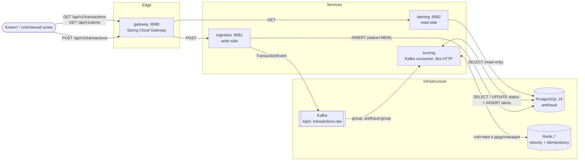
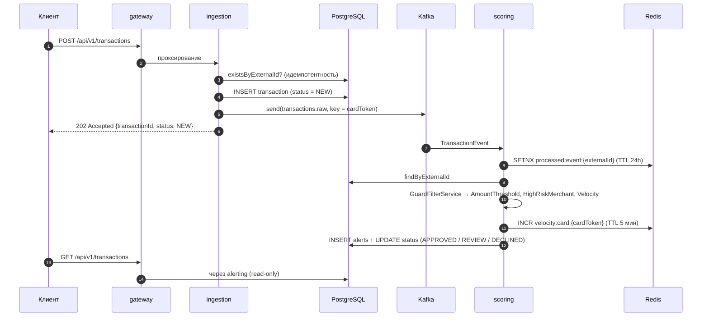

<div align="center">

# 🛡️ Anti-Fraud Monitor

**Событийная система антифрод-мониторинга платёжных транзакций в режиме близком к real-time**


</div>

---

## 📑 Содержание

1. [О проекте](#-о-проекте)
2. [Архитектура и структура модулей](#-архитектура-и-структура-модулей)
3. [Технологический стек](#-технологический-стек)
4. [Основной функционал](#-основной-функционал)
5. [Требования для запуска](#-требования-для-запуска)
6. [Сборка и запуск](#-сборка-и-запуск)
7. [REST API](#-rest-api)
8. [Конфигурация и переменные окружения](#️-конфигурация-и-переменные-окружения)
9. [Тестирование](#-тестирование)
10. [Планы по развитию / TODO](#-планы-по-развитию--todo)

---

## 📌 О проекте

**Anti-Fraud Monitor** — многомодульное Spring Boot-приложение, которое принимает платёжные транзакции, асинхронно прогоняет их через набор антифрод-правил и присваивает итоговое решение:

| Статус | Значение |
|:---|:---|
| `NEW` | Транзакция принята и сохранена, скоринг ещё не выполнен |
| `APPROVED` | Ни одно правило не сработало |
| `REVIEW` | Сработали правила уровня `MEDIUM`/`HIGH` — требуется ручная проверка |
| `DECLINED` | Сработало хотя бы одно правило уровня `CRITICAL` |

**Бизнес-задача.** Банк или платёжный провайдер должен быстро принимать поток транзакций, не блокируя приём тяжёлой аналитикой, и при этом фиксировать *почему* транзакция была помечена подозрительной. Проект решает её через:

- **разделение write- и read-стороны** (приём / скоринг / чтение результатов — три независимых сервиса);
- **асинхронный скоринг** через Kafka — приём отвечает `202 Accepted` сразу после сохранения;
- **расширяемый движок правил** (паттерн *Guard*) — новое правило добавляется одним `@Component`;
- **аудируемость** — каждое сработавшее правило сохраняется как отдельный `Alert` с severity и текстовым пояснением.

---

## 🏗 Архитектура и структура модулей

### Общая схема



### Жизненный цикл транзакции



### Структура репозитория

```text
anti-fraud-monitor/
├── pom.xml                      # parent POM (Spring Boot 4.1.2, Java 21, Spring Cloud BOM)
├── docker-compose.yaml          # Postgres, Redis, Kafka (KRaft), Kafka UI + все сервисы
├── amplicode.xml                # настройки persistence-юнитов для плагина Amplicode (IDE)
│
├── common/                      # 📦 библиотека (не запускается)
│   └── src/main/java/com/zverev/
│       ├── dto/                 #   TransactionEvent — контракт Kafka-события
│       ├── entity/              #   Transaction, Alert (JPA)
│       │   └── enums/           #   AlertSeverity, CurrencyCode, MerchantCountry, Rule, TransactionStatus
│       ├── exception/           #   TransactionNotFoundException
│       └── repository/          #   TransactionRepository, AlertRepository
│
├── ingestion/                   # ✍️ write-side, порт 8081
│   └── src/main/java/com/zverev/ingestion/
│       ├── controller/          #   TransactionController (POST)
│       ├── service/             #   TransactionService
│       ├── kafka/               #   TransactionEventProducer
│       ├── dto/                 #   TransactionRequest, TransactionCreatedResponse
│       ├── exception/           #   GlobalExceptionHandler, TransactionAlreadyExistsException
│       └── config/              #   JpaConfig
│
├── scoring/                     # 🧮 движок правил, Kafka-consumer (HTTP-слоя нет)
│   └── src/main/java/com/zverev/scoring/
│       ├── kafka/               #   TransactionEventConsumer
│       ├── service/             #   GuardFilterService
│       ├── guard/               #   Guard + AmountThresholdGuard, HighRiskMerchantGuard, VelocityGuard
│       └── dto/                 #   GuardViolation
│
├── alerting/                    # 📖 read-side, порт 8082
│   └── src/main/java/com/zverev/alerting/
│       ├── controller/          #   TransactionQueryController, AlertQueryController
│       ├── service/             #   TransactionQueryService, AlertQueryService
│       ├── dto/                 #   TransactionResponse, AlertResponse
│       └── config/              #   JpaConfig
│
└── gateway/                     # 🚪 единая точка входа, порт 8080
    └── src/main/resources/application.yaml   # маршруты (Spring Cloud Gateway, WebFlux)
```

### Назначение модулей

| Модуль | Роль | Порт | Postgres | Kafka | Redis | Тип |
|:---|:---|:---:|:---:|:---:|:---:|:---|
| **`common`** | Общая модель: JPA-сущности, репозитории, enum-ы, Kafka-контракт `TransactionEvent`, доменное исключение | — | — | — | — | Библиотека (jar) |
| **`ingestion`** | Приём транзакции: валидация, проверка дубликата по `externalId`, сохранение со статусом `NEW`, публикация события | `8081` | RW | producer | — | Spring MVC |
| **`scoring`** | Потребление событий, запуск всех `Guard`-правил, создание `Alert`-ов, расчёт итогового статуса | — | RW | consumer | RW | Non-web (только Kafka) |
| **`alerting`** | Только чтение: список транзакций (с алертами и маскированным номером карты) и список алертов | `8082` | RO | — | — | Spring MVC |
| **`gateway`** | Маршрутизация внешнего трафика к `ingestion` / `alerting` по пути и HTTP-методу | `8080` | — | — | — | Spring WebFlux |

### Взаимодействие компонентов

- **Синхронный путь** (`клиент → gateway → ingestion/alerting`): HTTP. `gateway` разводит запросы по паре *путь + метод* — `POST /api/v1/transactions` уходит в `ingestion`, `GET`-запросы — в `alerting`.
- **Асинхронный путь** (`ingestion → Kafka → scoring`): топик `transactions.raw`, ключ сообщения — `cardToken` (все транзакции одной карты попадают в одну партицию и обрабатываются строго по порядку), значение — JSON `TransactionEvent`.
- **Общая БД.** Все три сервиса работают с одной схемой PostgreSQL `antifraud` через общие сущности из `common`. Событие в Kafka содержит бизнес-данные, но `scoring` перечитывает транзакцию из БД по `externalId` — БД остаётся источником истины.
- **Redis** используется только `scoring`: для скользящего счётчика velocity и для дедупликации событий.

---

## 🧰 Технологический стек

### Платформа и сборка

| Технология | Версия | Назначение |
|:---|:---|:---|
| Java | **21** | Язык и рантайм (`java.version=21`) |
| Spring Boot | **4.1.2** | Родитель проекта (`spring-boot-starter-parent`) |
| Spring Cloud | **2025.1.4** | BOM для `spring-cloud-starter-gateway-server-webflux` |
| Apache Maven | multi-module | Сборка; `spring-boot-maven-plugin` (`repackage`) в исполняемых модулях |
| Lombok | управляется Boot BOM | Геттеры, конструкторы, builder, логгер (`@Slf4j`) |

### Web и API

| Технология | Версия | Модули |
|:---|:---|:---|
| Spring Web (MVC) | из Boot 4.1.2 | `ingestion`, `alerting` |
| Spring Cloud Gateway Server (WebFlux) | из Spring Cloud 2025.1.4 | `gateway` |
| Spring Boot Actuator | из Boot 4.1.2 | `gateway` (`health`, `info`, `gateway`) |
| Bean Validation (`spring-boot-starter-validation`, `jakarta.validation`) | из Boot 4.1.2 | `ingestion`, `common` |
| springdoc-openapi (Swagger UI) | **3.1.1** | `ingestion`, `alerting` (`webmvc-ui`), `gateway` (`webflux-ui`) |

### Данные и сообщения

| Категория | Технология | Версия | Применение |
|:---|:---|:---|:---|
| СУБД | PostgreSQL | **16** (образ `postgres:16`) | Хранение транзакций и алертов |
| ORM | Spring Data JPA / Hibernate | из Boot 4.1.2 | Репозитории и сущности в `common` |
| Брокер | Apache Kafka (KRaft, без ZooKeeper) | **3.7.0** (образ `apache/kafka:3.7.0`) | Топик `transactions.raw` |
| Kafka-клиент | `spring-boot-starter-kafka` | из Boot 4.1.2 | `JacksonJsonSerializer` / `JacksonJsonDeserializer`, `@RetryableTopic` |
| Кэш / счётчики | Redis | **7** (образ `redis:7-alpine`, `appendonly yes`) | Velocity-окно и дедупликация |
| Redis-клиент | `spring-boot-starter-data-redis` | из Boot 4.1.2 | `StringRedisTemplate` |
| Сериализация | `spring-boot-starter-jackson` | из Boot 4.1.2 | JSON-события |
| Отказоустойчивость | `@EnableResilientMethods` | Spring Framework (core) | Включено в `scoring` |

### Тестирование

| Технология | Где используется |
|:---|:---|
| JUnit 5 (`spring-boot-starter-test`) | Все модули |
| Mockito (`@ExtendWith(MockitoExtension.class)`, `@MockitoBean`, `ArgumentCaptor`) | Юнит-тесты сервисов, guard-ов и consumer-а |
| Spring MVC Test (`spring-boot-starter-webmvc-test`, `@WebMvcTest`, `MockMvc`) | Тесты контроллеров `ingestion` и `alerting` |
| H2 (scope `test`) | Подключена в `common` |

### Инфраструктура и инструменты

| Инструмент | Образ / версия | Назначение |
|:---|:---|:---|
| Docker Compose | `docker-compose.yaml` | Локальная инфраструктура и контейнеризованный запуск сервисов |
| Kafbat UI | `ghcr.io/kafbat/kafka-ui:latest` | Веб-интерфейс Kafka (порт `8090`) |
| Amplicode | `amplicode.xml` | Конфигурация persistence-юнитов для IDE-плагина |

---

## 🎯 Основной функционал

### 1. Приём транзакций (`ingestion`)

- Валидация входящего запроса (Bean Validation):
    - `externalId`, `currency`, `merchantCountry`, `occurredAt` — обязательны;
    - `cardToken`, `merchantName` — не пустые, ≤ 255 символов;
    - `amount` — строго положительный, до 15 знаков в целой и 4 в дробной части;
    - `occurredAt` — не в будущем (`@PastOrPresent`).
- **Идемпотентность по `externalId`**: повторная отправка той же транзакции → `409 Conflict`.
- Сохранение в БД со статусом `NEW`, затем публикация `TransactionEvent` в Kafka.
- Ответ `202 Accepted` с заголовком `Location` и телом `{ transactionId, status }`.
- Единый обработчик ошибок (`@RestControllerAdvice`): `400` (невалидное тело / поля), `409` (дубликат).

### 2. Антифрод-скоринг (`scoring`)

Движок построен на интерфейсе `Guard` — каждое правило независимо и возвращает `Optional<GuardViolation>`. `GuardFilterService` автоматически подхватывает **все** бины `Guard` и для каждого нарушения создаёт `Alert`.

| Правило (`Rule`) | Severity | Логика |
|:---|:---:|:---|
| `AMOUNT_THRESHOLD` | `MEDIUM` | Сумма **строго больше** порога для валюты: EUR/CHF — 5 000, CAD — 7 000, AUD — 8 000, BRL — 30 000, JPY — 800 000 |
| `HIGH_RISK_MERCHANT` | `HIGH` | Точное совпадение (регистрозависимое) `merchantName` с: `Casino`, `Online Poker`, `Crypto Exchange`, `Gambling`, `Wire Transfer` |
| `VELOCITY` | `CRITICAL` | Более **5** транзакций по одной карте за **5 минут** (Redis `INCR` + `EXPIRE`, ключ `velocity:card:{cardToken}`). При недоступности значения из Redis правило *fail-open* — не срабатывает |

**Расчёт итогового статуса:**

```text
нет алертов                  → APPROVED
есть алерты, нет CRITICAL    → REVIEW
есть хотя бы один CRITICAL   → DECLINED
```

**Надёжность обработки:**

- **Дедупликация событий** — `SET processed:event:{externalId} NX EX 24h` в Redis; повторная доставка того же события пропускается.
- **Retry с экспоненциальной паузой** — `@RetryableTopic(backOff = @BackOff(delay = 2000, multiplier = 2.0))`: Spring Kafka автоматически создаёт retry-топики и DLT.
- Consumer-метод выполняется в транзакции БД (`@Transactional`).

### 3. Чтение результатов (`alerting`)

- Список всех транзакций вместе с вложенными алертами.
- **Маскирование номера карты**: наружу отдаётся `**** 1234` (последние 4 символа токена), полный `cardToken` через API транзакций не раскрывается.
- Список всех сработавших алертов (`rule`, `severity`, `message`, `createdAt`).
- Все запросы выполняются в `@Transactional(readOnly = true)`.

### 4. Единая точка входа (`gateway`)

- Маршрутизация по пути и HTTP-методу, адреса апстримов переопределяются переменными `INGESTION_URI` и `ALERTING_URI`.
- Actuator-эндпоинты `health`, `info`, `gateway` (просмотр маршрутов).

---

## ✅ Требования для запуска

| Компонент | Версия | Примечание |
|:---|:---|:---|
| **JDK** | **21+** | `java -version` |
| **Apache Maven** | 3.9+ | Maven Wrapper в репозитории не обнаружен — нужен установленный `mvn` |
| **Docker** + **Docker Compose v2** | любая актуальная | Для PostgreSQL, Redis, Kafka |
| Свободные порты | `5433`, `6379`, `9092`, `8090`, `8080`, `8081`, `8082` | Postgres проброшен на **5433**, а не 5432 |

Запускать PostgreSQL, Redis и Kafka вручную не нужно — всё поднимается через `docker-compose.yaml`.

---

## 🚀 Сборка и запуск

Предусмотрено два режима: **A — инфраструктура в Docker, сервисы локально** (удобно для разработки) и **B — всё в контейнерах**.

### Режим A. Инфраструктура в Docker, сервисы локально

**1. Поднять инфраструктуру** (PostgreSQL, Redis, Kafka, Kafka UI):

```bash
docker compose up -d postgres redis kafka kafka-ui
docker compose ps        # дождитесь статуса healthy у postgres, redis и kafka
```

**2. Собрать все модули:**

```bash
mvn clean install
# без тестов:
mvn clean install -DskipTests
```

**3. Запустить сервисы — каждый в отдельном терминале и именно в таком порядке:**

```bash
# 1) ingestion — создаёт схему БД (ddl-auto: update)
mvn -pl ingestion spring-boot:run

# 2) scoring — Kafka-consumer
mvn -pl scoring spring-boot:run

# 3) alerting — только после того, как схема создана (ddl-auto: validate)
mvn -pl alerting spring-boot:run

# 4) gateway — единая точка входа
mvn -pl gateway spring-boot:run
```

Либо запуск собранных jar-файлов:

```bash
java -jar ingestion/target/ingestion-0.0.1-SNAPSHOT.jar
java -jar scoring/target/scoring-0.0.1-SNAPSHOT.jar
java -jar alerting/target/alerting-0.0.1-SNAPSHOT.jar
java -jar gateway/target/gateway-0.0.1-SNAPSHOT.jar
```

> ⚠️ **Порядок запуска важен.** В проекте нет миграций Flyway/Liquibase: схему создаёт Hibernate (`ddl-auto: update`) в `ingestion` и `scoring`, а `alerting` работает в режиме `validate` и **не стартует на пустой БД**. Сначала запускайте `ingestion` (или `scoring`), потом `alerting`.

### Режим B. Всё в Docker Compose

```bash
docker compose up -d --build
docker compose logs -f ingestion scoring alerting gateway
```

> ℹ️ Compose собирает образы по `<module>/Dockerfile` с контекстом в корне репозитория (`ingestion/Dockerfile`, `scoring/Dockerfile`, `alerting/Dockerfile`, `gateway/Dockerfile`). Эти файлы должны лежать в репозитории рядом с модулями.
>
> Из-за той же особенности со схемой БД (см. выше) `alerting` может упасть при самом первом старте, если стартанул раньше `ingestion`. В этом случае достаточно: `docker compose restart alerting`.

### Проверка работоспособности

```bash
# Gateway и маршруты
curl http://localhost:8080/actuator/health
curl http://localhost:8080/actuator/gateway/routes

# Swagger UI сервисов
#   http://localhost:8081/swagger-ui/index.html   (ingestion)
#   http://localhost:8082/swagger-ui/index.html   (alerting)
#   http://localhost:8080/swagger-ui.html         (gateway)
# Kafka UI
#   http://localhost:8090
```

### Сценарий end-to-end

**bash:**

```bash
curl -i -X POST http://localhost:8080/api/v1/transactions \
  -H "Content-Type: application/json" \
  -d '{
        "externalId": "'"$(uuidgen)"'",
        "cardToken": "tok_4111111111111234",
        "amount": 9500.00,
        "currency": "EUR",
        "merchantName": "Casino",
        "merchantCountry": "GERMANY",
        "occurredAt": "2026-10-29T10:00:00Z"
      }'

# через пару секунд — результат скоринга (REVIEW: сработали AMOUNT_THRESHOLD и HIGH_RISK_MERCHANT)
curl -s http://localhost:8080/api/v1/transactions
curl -s http://localhost:8080/api/v1/alerts
```

**PowerShell:**

```powershell
$body = @{
    externalId      = [guid]::NewGuid().ToString()
    cardToken       = "tok_4111111111111234"
    amount          = 9500.00
    currency        = "EUR"
    merchantName    = "Casino"
    merchantCountry = "GERMANY"
    occurredAt      = "2026-10-29T10:00:00Z"
} | ConvertTo-Json

Invoke-RestMethod -Method Post -Uri http://localhost:8080/api/v1/transactions `
    -ContentType "application/json" -Body $body

Invoke-RestMethod -Uri http://localhost:8080/api/v1/transactions
Invoke-RestMethod -Uri http://localhost:8080/api/v1/alerts
```

**Проверка VELOCITY** — отправьте 6 транзакций по одной карте менее чем за 5 минут; шестая получит алерт `CRITICAL` и статус `DECLINED`:

```bash
for i in $(seq 1 6); do
  curl -s -o /dev/null -w "tx $i -> HTTP %{http_code}\n" -X POST http://localhost:8080/api/v1/transactions \
    -H "Content-Type: application/json" \
    -d '{"externalId":"'"$(uuidgen)"'","cardToken":"tok_velocity_test","amount":10,
         "currency":"EUR","merchantName":"Shop","merchantCountry":"GERMANY",
         "occurredAt":"2026-10-29T10:00:00Z"}'
done
```

### Остановка и очистка

```bash
docker compose down            # остановить контейнеры, сохранить данные
docker compose down -v         # + удалить тома pgdata, redisdata, kafkadata
```

---

## 🔌 REST API

Внешний клиент работает **только через gateway** (`http://localhost:8080`). Прямые адреса сервисов нужны для отладки.

### Маршруты gateway

| Маршрут (`id`) | Путь | Метод | Апстрим |
|:---|:---|:---:|:---|
| `ingestion-create` | `/api/v1/transactions` | `POST` | `ingestion` — `${INGESTION_URI:http://localhost:8081}` |
| `alerting-transactions` | `/api/v1/transactions` | `GET` | `alerting` — `${ALERTING_URI:http://localhost:8082}` |
| `alerting-alerts` | `/api/v1/alerts` | `GET` | `alerting` — `${ALERTING_URI:http://localhost:8082}` |

### `POST /api/v1/transactions` — принять транзакцию *(ingestion)*

**Тело запроса:**

| Поле | Тип | Ограничения |
|:---|:---|:---|
| `externalId` | UUID | обязательное, уникальное |
| `cardToken` | string | не пустое, ≤ 255 |
| `amount` | decimal | `> 0`, до 15 цифр до запятой и 4 после |
| `currency` | enum | `CAD`, `EUR`, `JPY`, `BRL`, `AUD`, `CHF` |
| `merchantName` | string | не пустое, ≤ 255 |
| `merchantCountry` | enum | `CANADA`, `GERMANY`, `JAPAN`, `BRAZIL`, `AUSTRALIA`, `SWITZERLAND` |
| `occurredAt` | ISO-8601 instant | не в будущем |

**Ответы:**

| Код | Когда | Тело |
|:---:|:---|:---|
| `202 Accepted` | Транзакция принята | `{"transactionId": 1, "status": "NEW"}` + заголовок `Location: /api/v1/transactions/1` |
| `400 Bad Request` | Ошибка валидации / нечитаемое тело | `{"error": "amount: must be greater than 0"}` |
| `409 Conflict` | `externalId` уже существует | `{"error": "duplicate_transaction", "message": "...", "externalId": "..."}` |

### `GET /api/v1/transactions` — список транзакций *(alerting)*

Возвращает все транзакции с результатом скоринга и вложенными алертами:

```json
[
  {
    "id": 1,
    "cardTokenMasked": "**** 1234",
    "amount": 9500.0000,
    "currency": "EUR",
    "merchantName": "Casino",
    "merchantCountry": "GERMANY",
    "status": "REVIEW",
    "occurredAt": "2026-10-29T10:00:00Z",
    "createdAt": "2026-10-29T10:00:01.123Z",
    "alerts": [
      {
        "rule": "AMOUNT_THRESHOLD",
        "severity": "MEDIUM",
        "message": "Amount 9500.0000 EUR exceeds threshold 5000 EUR",
        "createdAt": "2026-10-29T10:00:02Z"
      },
      {
        "rule": "HIGH_RISK_MERCHANT",
        "severity": "HIGH",
        "message": "High-risk merchant category: Casino",
        "createdAt": "2026-10-29T10:00:02Z"
      }
    ]
  }
]
```

### `GET /api/v1/alerts` — список алертов *(alerting)*

```json
[
  {
    "rule": "VELOCITY",
    "severity": "CRITICAL",
    "message": "Velocity exceeded for card tok_velocity_test: 6 transactions in last 5 minutes",
    "createdAt": "2026-10-29T10:03:11Z"
  }
]
```

### Справочник перечислений

| Enum | Значения |
|:---|:---|
| `TransactionStatus` | `NEW`, `APPROVED`, `REVIEW`, `DECLINED` |
| `AlertSeverity` | `LOW`, `MEDIUM`, `HIGH`, `CRITICAL` |
| `Rule` | `AMOUNT_THRESHOLD`, `HIGH_RISK_MERCHANT`, `VELOCITY` |

### OpenAPI

| Сервис | Спецификация | UI |
|:---|:---|:---|
| ingestion | `http://localhost:8081/v3/api-docs` | `http://localhost:8081/swagger-ui/index.html` |
| alerting | `http://localhost:8082/v3/api-docs` | `http://localhost:8082/swagger-ui/index.html` |
| gateway | `http://localhost:8080/v3/api-docs` | `http://localhost:8080/swagger-ui.html` |

---

## ⚙️ Конфигурация и переменные окружения

Все настройки лежат в `src/main/resources/application.yaml` соответствующего модуля. Благодаря *relaxed binding* Spring Boot любое свойство можно переопределить переменной окружения (`spring.datasource.url` → `SPRING_DATASOURCE_URL`).

### Значения по умолчанию

| Параметр | ingestion | scoring | alerting | gateway |
|:---|:---|:---|:---|:---|
| `spring.application.name` | `ingestion-service` | `scoring-service` | `alerting-service` | `gateway` |
| `server.port` | `8081` | не задан (non-web) | `8082` | `8080` |
| `spring.datasource.url` | `jdbc:postgresql://localhost:5433/antifraud` | то же | то же | — |
| `spring.datasource.username` / `password` | `antifraud` / `antifraud` | то же | то же | — |
| `spring.jpa.hibernate.ddl-auto` | `update` | `update` | **`validate`** | — |
| `spring.jpa.show-sql` | `true` (+ `format_sql`) | `true` | `true` | — |
| `spring.kafka.bootstrap-servers` | `localhost:9092` | `localhost:9092` | — | — |
| `spring.data.redis.host` / `port` | — | `localhost` / `6379` | — | — |

### Переменные окружения

| Переменная | Сервис(ы) | Назначение | Локально | В Docker Compose |
|:---|:---|:---|:---|:---|
| `SPRING_DATASOURCE_URL` | ingestion, scoring, alerting | JDBC URL PostgreSQL | `jdbc:postgresql://localhost:5433/antifraud` | `jdbc:postgresql://postgres:5432/antifraud` |
| `SPRING_DATASOURCE_USERNAME` | ingestion, scoring, alerting | Пользователь БД | `antifraud` | `antifraud` |
| `SPRING_DATASOURCE_PASSWORD` | ingestion, scoring, alerting | Пароль БД | `antifraud` | `antifraud` |
| `SPRING_KAFKA_BOOTSTRAP_SERVERS` | ingestion, scoring | Адрес Kafka | `localhost:9092` | `kafka:29092` |
| `SPRING_DATA_REDIS_HOST` | scoring | Хост Redis | `localhost` | `redis` |
| `SPRING_DATA_REDIS_PORT` | scoring | Порт Redis | `6379` | `6379` |
| `INGESTION_URI` | gateway | URL сервиса ingestion | `http://localhost:8081` | `http://ingestion:8081` |
| `ALERTING_URI` | gateway | URL сервиса alerting | `http://localhost:8082` | `http://alerting:8082` |
| `SERVER_PORT` | ingestion, alerting, gateway | Порт HTTP-сервера | `8081` / `8082` / `8080` | — |

> 🔐 Учётные данные `antifraud/antifraud` — **только для локальной разработки**. Для любых других окружений передавайте креды через переменные окружения или секрет-хранилище.

### Kafka

```properties
# Топик
transactions.raw                       # ключ = cardToken, значение = JSON TransactionEvent

# producer (ingestion)
spring.kafka.producer.key-serializer=org.apache.kafka.common.serialization.StringSerializer
spring.kafka.producer.value-serializer=org.springframework.kafka.support.serializer.JacksonJsonSerializer

# consumer (scoring)
spring.kafka.consumer.group-id=antifraud-group
spring.kafka.consumer.auto-offset-reset=earliest
spring.kafka.consumer.key-deserializer=org.apache.kafka.common.serialization.StringDeserializer
spring.kafka.consumer.value-deserializer=org.springframework.kafka.support.serializer.JacksonJsonDeserializer
spring.kafka.consumer.properties.spring.json.trusted.packages=*
```

В `docker-compose.yaml` брокер поднят в режиме KRaft с двумя listener-ами: `EXTERNAL` (`localhost:9092`) — для приложений на хосте, `INTERNAL` (`kafka:29092`) — для контейнеров. Количество партиций по умолчанию — `3`.

### Инфраструктура в Docker Compose

| Сервис | Контейнер | Порт хоста → контейнера | Тома |
|:---|:---|:---:|:---|
| PostgreSQL 16 | `antifraud-postgres` | `5433 → 5432` | `pgdata` |
| Redis 7 | `antifraud-redis` | `6379 → 6379` | `redisdata` |
| Kafka 3.7.0 | `antifraud-kafka` | `9092 → 9092` | `kafkadata` |
| Kafka UI | `antifraud-kafka-ui` | `8090 → 8080` | — |
| ingestion | `antifraud-ingestion` | `8081 → 8081` | — |
| scoring | `antifraud-scoring` | — | — |
| alerting | `antifraud-alerting` | `8082 → 8082` | — |
| gateway | `antifraud-gateway` | `8080 → 8080` | — |

Для `postgres`, `redis` и `kafka` настроены healthcheck-и; прикладные сервисы стартуют по `depends_on: condition: service_healthy`.

---

## 🧪 Тестирование

```bash
mvn test                      # все модули
mvn -pl scoring test          # один модуль
mvn -pl scoring -am test      # модуль вместе с зависимостями
```

| Модуль | Тестовый класс | Что покрыто |
|:---|:---|:---|
| `ingestion` | `TransactionControllerTest` (`@WebMvcTest`) | `202` для валидного запроса, `400` без `externalId`, `400` для отрицательной суммы, `409` для дубликата |
| `ingestion` | `TransactionServiceTest` (Mockito) | Сохранение со статусом `NEW` и публикация события; при дубликате — исключение без сохранения и без события |
| `scoring` | `AmountThresholdGuardTest` | Ниже порога, ровно на пороге (строгое `>`), выше порога, пороги по валютам (JPY) |
| `scoring` | `HighRiskMerchantGuardTest` | Обычный мерчант, `Casino`, регистрозависимость |
| `scoring` | `VelocityGuardTest` | 1-я транзакция (установка TTL), 5-я (без нарушения), 6-я (`CRITICAL`), `null` из Redis (fail-open) |
| `scoring` | `TransactionEventConsumerTest` | `APPROVED` / `REVIEW` / `DECLINED`, пропуск дубликата, `TransactionNotFoundException` |
| `alerting` | `TransactionQueryControllerTest` (`@WebMvcTest`) | `200` со списком и маскированной картой, `200` с пустым списком |

Интеграционные тесты с реальными PostgreSQL / Kafka / Redis (например, на Testcontainers) в проекте пока отсутствуют.

---

## 🗺 Планы по развитию / TODO

Список составлен по результатам анализа кода. Приоритеты: 🔴 высокий (корректность / безопасность), 🟡 средний, 🟢 низкий.

### 🔴 Корректность и надёжность

- [ ] **Идемпотентность в `scoring` может «терять» события при ретраях.** `TransactionEventConsumer` ставит Redis-ключ `processed:event:{externalId}` **до** обработки и не снимает его при ошибке. Если обработка упала (например, `TransactionNotFoundException`), повторная попытка из `@RetryableTopic` увидит ключ, молча завершится — а транзакция навсегда останется в `NEW`. Решение: ставить ключ после успешного коммита либо удалять его в `catch`/через `TransactionSynchronization`, либо перейти на идемпотентность на уровне БД (проверка статуса `NEW`).
- [ ] **Гонка между коммитом и публикацией события в `ingestion`.** `kafkaTemplate.send` вызывается внутри `@Transactional` метода до коммита: `scoring` может получить событие раньше, чем транзакция станет видна в БД. Решение — **Transactional Outbox** (таблица `outbox` + публикация отдельным поллером/Debezium) или публикация через `@TransactionalEventListener(phase = AFTER_COMMIT)`.
- [ ] **Velocity-счётчик не откатывается** при ретрае/ошибке: `INCR` выполняется до сохранения результата, повторная обработка завладеет «лишней» единицей и может дать ложный `CRITICAL`. Рассмотреть Lua-скрипт/скользящее окно на `ZSET` с привязкой к `occurredAt`.
- [ ] **Нет миграций БД.** Схему создаёт Hibernate (`ddl-auto: update`) в двух сервисах одновременно, а `alerting` в режиме `validate` падает на пустой БД. Внедрить **Flyway** или **Liquibase**, перевести все сервисы на `validate`.
- [ ] **Нет обработчика DLT.** После исчерпания ретраев сообщение уходит в Dead Letter Topic, но никто его не читает. Добавить `@DltHandler`, метрики и алертинг.
- [ ] **`Location`-заголовок ведёт в никуда.** `POST` возвращает `Location: /api/v1/transactions/{id}`, но `GET /api/v1/transactions/{id}` не реализован.

### 🔴 Безопасность

- [ ] **Утечка номера карты через алерты.** `VelocityGuard` включает полный `cardToken` в `message`, а `GET /api/v1/alerts` отдаёт `message` без маскирования — это обходит маскирование в `TransactionResponse`. Использовать замаскированный токен в тексте алерта.
- [ ] **Токен карты хранится в БД открытым текстом.** Рассмотреть хэширование/шифрование на уровне приложения или БД.
- [ ] **Нет аутентификации и авторизации** на `gateway` (Spring Security + OAuth2/JWT, разделение ролей для write/read), нет rate limiting.
- [ ] **Хардкод учётных данных** в `application.yaml` (и `trusted.packages: "*"` у десериализатора Kafka). Вынести секреты во внешние источники, сузить список доверенных пакетов до `com.zverev.dto`.

### 🟡 Производительность и API

- [ ] **Нет пагинации и фильтров.** `findAll()` в `alerting` грузит всё в память. Добавить `Pageable`, фильтры (статус, карта, период, severity) и сортировку.
- [ ] **N+1 при выдаче транзакций.** Коллекция `alerts` ленивая и подгружается по одной транзакции — использовать `@EntityGraph` / `JOIN FETCH` или DTO-проекции.
- [ ] Добавить `GET /api/v1/transactions/{id}` и `GET /api/v1/transactions?externalId=...`.
- [ ] Для read-side рассмотреть отдельную реплику БД или CQRS-проекцию.
- [ ] Перевести ключ Redis и окно velocity на конфигурируемые значения (сейчас окно 5 мин и лимит 5 захардкожены).

### 🟡 Движок правил

- [ ] **Вынести параметры правил в конфигурацию** (`@ConfigurationProperties`): пороги по валютам, список high-risk мерчантов, окно и лимит velocity. Сейчас они — константы в коде.
- [ ] Список high-risk мерчантов сравнивается по точному совпадению строки с учётом регистра — перейти на категории (MCC), нормализацию и/или справочник в БД.
- [ ] Новые правила: гео-аномалии (несовпадение страны мерчанта и истории карты), нетипичное время суток, резкий рост среднего чека, чёрные/белые списки карт.
- [ ] Использовать уровень `LOW` (объявлен в `AlertSeverity`, но ни одно правило его не выдаёт) и взвешенный скоринг вместо простой логики «есть CRITICAL → DECLINED».
- [ ] Пороги в `AmountThresholdGuard` заданы в номинале валюты — привести к единой базовой валюте через курсы.

### 🟢 Качество кода и DevOps

- [ ] Убрать неиспользуемую зависимость `spring-boot-starter-kafka` из `alerting`.
- [ ] Унифицировать JPA-конфигурацию: сейчас `@EntityScan`/`@EnableJpaRepositories` дублируются в `JpaConfig` двух модулей и вынесены в `@SpringBootApplication`-класс в `scoring`. Вынести в auto-configuration/`@Import` из `common`.
- [ ] `@EnableResilientMethods` включён в `scoring`, но `@Retryable`/`@ConcurrencyLimit` нигде не используются — применить или убрать.
- [ ] Добавить интеграционные тесты на **Testcontainers** (PostgreSQL + Kafka + Redis), контрактные тесты для `TransactionEvent`.
- [ ] Observability: Actuator, Micrometer + Prometheus, Grafana-дашборды, распределённая трассировка (Micrometer Tracing / OpenTelemetry), структурированные логи с `externalId` в MDC. Actuator сейчас подключён только в `gateway`.
- [ ] Отключить `spring.jpa.show-sql` вне профиля `dev`; завести профили `dev` / `docker` / `prod`.
- [ ] CI-пайплайн (GitHub Actions / GitLab CI): `mvn verify`, сборка образов, сканирование зависимостей.
- [ ] Агрегация Swagger всех сервисов в UI `gateway`.
- [ ] Закрепить версию образа `kafka-ui` (сейчас `latest`) для воспроизводимости.
- [ ] Добавить Maven Wrapper (`mvnw`) для воспроизводимой сборки без установленного Maven.

---

<div align="center">

**Anti-Fraud Monitor** · Java 21 · Spring Boot 4.1.2 · Kafka · PostgreSQL · Redis

</div>
